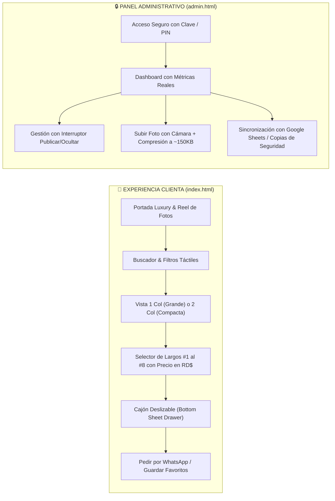

# KENDRA NAILS — MOBILE-FIRST ULTRA (PWA & PANEL DE CONTROL)
> **✦ Uñas que hablan de ti ✦**  
> Solución digital profesional diseñada desde cero para teléfonos móviles (iPhone y Android), separando la experiencia de clientas de la administración del negocio.

---

## 📱 Dos Experiencias Separadas y Optimizadas para Teléfonos

---

## 🌟 Enlaces Rápidos de Acceso

- **Catálogo Público para Clientas**:
  - En tu computadora: **`http://localhost:8080/index.html`**
  - En tu celular (mismo Wi-Fi): **`http://10.0.0.25:8080/index.html`**
  - Archivo directo: [`index.html`](file:///c:/Users/ADMIN/OneDrive/Documentos/Catalogo%20Nails/index.html)

- **Panel Privado de Administración**:
  - En tu computadora: **`http://localhost:8080/admin.html`**
  - En tu celular (mismo Wi-Fi): **`http://10.0.0.25:8080/admin.html`**
  - Archivo directo: [`admin.html`](file:///c:/Users/ADMIN/OneDrive/Documentos/Catalogo%20Nails/admin.html)
  - **Clave por defecto**: `kendra2026` *(editable en la sección Ajustes)*.

---

## 📲 Cómo Instalar en la Pantalla de Inicio de tu Celular (PWA)

Tanto el **Catálogo Público** como el **Panel de Administración** están preparados con Service Worker y manifiestos web para instalarse como aplicaciones nativas sin pasar por App Store ni Google Play:

### En iPhone (Safari):
1. Abre el enlace (`index.html` para el catálogo o `admin.html` para la administración).
2. Toca el botón central **Compartir** (el icono de un cuadro con una flecha hacia arriba).
3. Desliza hacia abajo y selecciona **«Añadir a la pantalla de inicio»**.
4. ¡Listo! Se creará un icono con el logo de Kendra Nails que se abre a pantalla completa sin barra de navegación.

### En Android (Google Chrome):
1. Abre el enlace en Chrome.
2. Toca el menú de los **tres puntos verticales** (arriba a la derecha).
3. Selecciona **«Instalar aplicación»** o **«Añadir a pantalla principal»**.
4. Se instalará como una app independiente en tu teléfono.

---

## 🛠️ Panel de Control Móvil (`admin.html`)

Diseñado para usarse con una sola mano y el pulgar:

### 1. Inicio (Dashboard)
- **Métricas reales**: Diseños publicados, Total de diseños en inventario, Diseños ocultos (pausados o borradores) y Diseños por revisar (con notas).
- **Accesos rápidos**: Agregar nuevo diseño, editar precios y descargar copias de seguridad.

### 2. Gestión de Diseños
- Búsqueda en tiempo real por nombre, técnica o precio.
- Filtros por estado (*Todos, Publicados, Ocultos, Con Notas*).
- **Interruptor de publicación con un solo toque**: activa o desactiva la visibilidad de cualquier diseño de forma inmediata.
- Botón **Editar** para modificar nombres, precios o descripciones.

### 3. Agregar Diseños desde la Cámara o Galería
- Al tocar el recuadro de foto, se abre directamente la **cámara del teléfono** o la galería de fotos.
- **Compresor automático en el navegador**: Las cámaras de teléfonos modernos generan fotos de 5 a 12 MB. El panel las comprime automáticamente a ~150 KB manteniendo alta nitidez antes de guardarlas, garantizando carga instantánea para las clientas.
- Permite fijar el precio base, marcar como destacado y decidir si se publica de inmediato o se guarda como borrador.

### 4. Ajustes y Sincronización
- Descarga de plantilla CSV para Google Sheets.
- Descarga de copia de seguridad completa en JSON.
- Cambio de clave de acceso.

---

## ☁️ Integración Gratuita con Google Sheets (Backend Serverless)

En la carpeta [`backend/google_apps_script.js`](file:///c:/Users/ADMIN/OneDrive/Documentos/Catalogo%20Nails/backend/google_apps_script.js) se incluye el código completo y listo para copiar en Google Sheets:

1. En tu Google Drive, abre tu hoja de cálculo de Google Sheets.
2. Ve al menú superior: **Extensiones > Apps Script**.
3. Pega el código de `google_apps_script.js`.
4. Haz clic en **Implementar > Nueva implementación**.
5. Selecciona tipo **Aplicación Web**, acceso **Cualquier usuario** y pulsa **Implementar**.
6. Copia la URL generada y pégala en los ajustes de tu panel móvil.

### Límites del Plan Gratuito de Google:
- **Ejecuciones**: 20,000 llamadas al día (un salón suele usar menos de 100 llamadas al día).
- **Almacenamiento**: Gratuito dentro de los 15 GB de tu cuenta de Google.
- **Costo**: $0.00 USD para siempre.

---

## 💅 Catálogo Público para Clientas (`index.html`)

- **Diseño 100% separado**: Las clientas no ven ningún botón de administración ni configuraciones internas.
- **Selector de vista móvil**:
  - `📱 1 Columna`: Vista grande tipo feed editorial de Instagram para admirar el arte en detalle.
  - `🔲 2 Columnas`: Cuadrícula compacta para comparar precios y diseños rápidamente.
- **Selector táctil de largos (#1 al #8)** con precios exactos en pesos dominicanos (`RD$`).
- **Cajón deslizable inferior (*Bottom Sheet Drawer*)** con pestañas para ver la foto real, la escala de largos y el afiche original.
- **Botón directo de WhatsApp** fijado abajo al alcance del pulgar.
- **Soporte offline**: Funciona incluso con conexión inestable gracias al Service Worker [`sw.js`](file:///c:/Users/ADMIN/OneDrive/Documentos/Catalogo%20Nails/sw.js).
